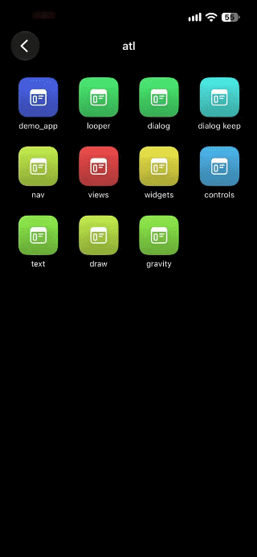

# dine - android compat layer for iPhone

Goal: run Android apps on iPhone via ATL + ART. Most work happens on Linux (ATL/ART,
`-Xint` reproduces the no-JIT iPhone situation); only iOS-specific parts need the device.



```sh
source env.sh          # for direct tool use; tools/dine sources it itself
tools/dine --help      # the single entry point: ios, linux, test, dbg
```

## First-time setup

See **[docs/first-run.md](docs/first-run.md)**: Windows prerequisites, every system package
(pacman + paru), the uv-managed `.venv` (Python tooling), device bridge, xtool, iOS SDK, debugger
symbols, ATL build, and a verification checklist.

## Layout

| Path | What |
|---|---|
| `env.sh` | `PATH` (`.venv/bin`, `out/tools/bin`), `DINE_IOS_SDK`, `DINE_IOS_SWIFT_RESOURCES`, `DINE_LLDB`, Linux prefix/pkg-config paths |
| `pyproject.toml`, `uv.lock` | Python tooling for the in-repo `.venv` (`uv sync`): Python 3.12, pymobiledevice3, meson, uidrive |
| `docs/first-run.md` | setup on a new PC: every package, where each tool comes from |
| `tools/dine` | the single entry point (sources `env.sh`); commands below, `tools/dine <group> --help` |
| `tools/py/dine/` | its Python package: CLI, device helpers (`ios.py`), debug server and client (`dbg/`) |
| `tools/libexec/` | what `dine` runs: `build-ios-native.sh`, `build-ios-assets.sh` (accord), `build-linux-stack.sh`, `ios-core.py` (synthetic core), `lldb` (Swift toolchain lldb run from `out/lldb/` with the iOS Swift resource dir; borrows libpython3.12 from the `.venv`) |
| `tools/systemd/usbmuxd-bridge.service` | `/var/run/usbmuxd` → Windows Apple Mobile Device Service (`127.0.0.1:27015`) |
| `tools/systemd/dine-tunneld.service` | `pymobiledevice3 remote tunneld` (iOS 17+ developer services) |
| `tools/cmake/ios.toolchain.cmake` | clang cross-compile → `arm64-apple-ios` with xtool's SDK |
| `native/dev/` | libs only dev builds link: `hello` (C++ static lib smoke test), `runtimetests` |
| `apps/Dine` | xtool SwiftUI app: launcher grid (SQLite); dev builds add `Sources/Dine/Dev/`: a hello++ screen linking `native/dev/hello`, a probe screen for the asset catalogs (`Resources/`: `AppIcon.icon`, `Assets.xcassets`, `Icons.xcassets` from the icon pack, dev-only `Dev.xcassets`), art and atl run screens |
| `../dine-accord` | sibling repo where accord is worked on: Dine's `actool`, which compiles `apps/<App>/Resources` into `Assets.car` + icon plist keys. Dine runs the `accord` command, cargo-installed from its GitHub repo |
| `../dine-uidrive` | sibling repo where uidrive is worked on: the UI agent that `ios launch` injects into dev builds (`dev/libuidrive.dylib`, built by `ios run`) and the Python client `dbg` talks to it with. `uv sync` installs it from its GitHub repo at a pinned commit; [`notes/dev-reference.md`](notes/dev-reference.md#ui-agent) says how to use the checkout instead |
| `third_party/` | upstream clones (gitignored): bionic_translation, libopensles (Linux); lz4, xz, icu, wolfssl (iOS deps); fluentui-system-icons (the icon pack); `apks/`, the third-party test APKs |
| `dine-art/` | submodule: our fork of art_standalone (ART + libcore), branch `dine` |
| `dine-atl/` | submodule: our fork of android_translation_layer, branch `dine` |
| `tools/bin/d8` | build-tools d8 on JDK 21 (on `PATH` via `env.sh`), used by the ART/ATL build and the tests |
| `tests/` | test engine (`harness/`), app and launcher tests; component suites live in `dine-art/tests`, `dine-atl/tests` |

## Commands

| Command | What |
|---|---|
| `tools/dine ios tunnel start\|status` | iOS 17+ developer services: `dine-tunneld` runs from boot; `start` starts it if stopped (sudo), waits for the tunnel and mounts the DDI (after a phone reboot) |
| `tools/dine ios build-native [lib…]` | `native/*`, plus `native/dev/*` unless `DINE_RELEASE=1` (which removes those a dev build left) → `out/ios/{lib,include}` (`DINE_IOS_BUILD_TYPE`, default `RelWithDebInfo`) |
| `tools/dine ios build-art` | dine-art (ART, libcore natives, androidfw) plus ICU, lz4, liblzma, wolfSSL → static archives in `out/ios/lib`, boot jars → `out/ios/share/art` (ART's junit jars → `out/ios/share/art-junit`, bundled by dev builds only) |
| `tools/dine ios build-atl` | dine-atl's uikit build (meson cross) → `out/ios/lib/libtranslation_layer_main.a`; its jars → `out/ios/share/atl`; needs `linux build atl` first |
| `tools/dine ios run [App]` | kill a running instance → native libs → dev payload, built from its sources (ATL's test APKs → `out/tests/apks`, the runtime suite's authored jars, the package suite's installer app; all bundled from `out/ios/dev`) → asset catalog (accord → `out/ios/assets/<App>`) → `xtool dev` (build/sign/install) → launch via DVT. `DINE_RELEASE=1` (after `DINE_RELEASE=1 tools/dine ios build-atl`): a release build without dev or test code (CLAUDE.md); its last step reads the bundle and fails on a dev or test part |
| `tools/dine ios icons` | `apps/Dine/Resources/Icons.xcassets` from its `sources.txt`: copies the listed icons from the pack's clone |
| `tools/dine ios launch [--suspended] [App]` | (re)launch via DVT, print the pid |
| `tools/dine ios ps [App] [--all]`, `tools/dine ios kill <App\|pid>` | device processes |
| `tools/dine ios logs [App]` | live syslog to the terminal |
| `tools/dine ios symbols` | phone's dyld shared cache → per-dylib files in `out/ios-symbols/` (lldb `--sysroot`) |
| `tools/dine ios lldb [--suspended] [App] [-- lldb args]` | interactive: launch + attach Swift lldb through the tunnel |
| `tools/dine ios lldb-offline [App] <bp> [-- lldb args]` | same lldb setup on a synthetic core, no phone |
| `tools/dine dbg …` | the debug server: see [Debug server](#debug-server) |
| `tools/dine linux build [stage…]` | bionic_translation → dine-art → libopensles → dine-atl → `out/linux/prefix`, then headless dine-atl in `out/linux/build/dine-atl-headless` |
| `tools/dine linux smoke [check…] [--list]` | checks of ATL's gtk build (on a hidden display) and its headless build on test APKs (after `linux build`); `--list` has every check |
| `tools/dine test runtime [fetch\|build\|run\|all] [-f REGEX] [--update-expectations]` | ART run-tests on the local `dalvikvm -Xint` (suite `dine-art/tests/runtime`, engine `tests/harness`); `tools/dine test runtime -- --help` lists every option |
| `tools/dine test framework [-f REGEX] [--gtk \| --one-vm] [--update-expectations]` | `android.*` JUnit suites in-VM on the headless ATL build, the gtk one with `--gtk`, or side by side as apps of one headless VM with `--one-vm` (suite `dine-atl/tests/framework`, after `linux build`) |
| `tools/dine test apps [-f REGEX] [--gtk] [--update-expectations]` | real APKs (`tests/android-compat/apps/apps.toml` lists them) to their log markers on the headless ATL build, or the gtk one with `--gtk` (after `linux build`) |
| `tools/dine test package [-f REGEX] [--update-expectations]` | package install, query and removal on the headless ATL build: CLI installs graded on the registry's rows, a JUnit suite of `PackageManager` queries, and an installer app's sessions and intents with scripted dialog answers (suite `dine-atl/tests/package`, after `linux build`) |
| `tools/dine test unit` | unit tests of `tests/harness` and `tools/py`, and the edge classifier's (`tests/launcher`, built with swiftc) |

## Device connection

The iPhone stays attached to **Windows** (Apple Devices / iTunes driver, AMDS service).
WSL uses mirrored networking, so `127.0.0.1:27015` is Windows' usbmuxd; the
`usbmuxd-bridge` unit (socat) exposes it as `/var/run/usbmuxd`. Pair records are
served by AMDS. Do **not** install Arch's `usbmuxd` daemon or use usbipd
(xtool#19: usbipd → "message was too large" / `muxError`).

```sh
idevice_id -l                       # UDID
ideviceinfo -k ProductVersion
pymobiledevice3 usbmux list
```

Fallback if the unit is down: `export USBMUXD_SOCKET_ADDRESS=127.0.0.1:27015`.

## iOS app build / install / launch

```sh
tools/dine ios run                   # = ios build-native + xtool dev + DVT launch
```

- `xtool launch` / the launch step of `xtool dev` fail with `DebugserverClient.Error.unknown`
  (pre-iOS-17 debugserver). Launch with
  `pymobiledevice3 developer dvt launch --tunnel '' XTL-<TeamID>.<bundleID>` (what `ios run`/`ios launch` do).
- Free accounts install as `XTL-<TeamID>.<bundleID>` (e.g. `XTL-97U7V3FX2D.dev.dine.Dine`).
- xtool crashes with stdin = `/dev/null` (`epoll_ctl ... Operation not permitted`); `ios run` gives it a pty
  when not on a terminal. Its prompts (certificate revocation) still need a real terminal.
- **Keep the phone unlocked, app in foreground.** Locked → launch fails (same error as untrusted
  cert). Backgrounded → app suspended then killed. After reboot unlock once. Tip: Auto-Lock → Never.
- Free Apple ID: certs last **7 days** (re-run `tools/dine ios run`), max 3 sideloaded apps.
- First install: iPhone → Settings → General → VPN & Device Management → trust the developer.
- `xtool auth status`, `xtool sdk status`.
- Native libs: link prebuilt `.a` via a `.systemLibrary` module map + `-L` unsafeFlags
  (see `apps/Dine/Package.swift`, `Sources/CDineHello/module.modulemap`).

## Logs / crashes

```sh
tools/dine ios logs                  # = pymobiledevice3 syslog live -pn Dine
pymobiledevice3 crash pull out/crashes
```

Use `os.Logger` (`log.notice(...)`, `privacy: .public` for dynamic strings) — `print()` goes to
stdout and never reaches syslog.

## Debug server

One server process per debugging session, driven by `tools/dine dbg …`. It owns lldb (SB API in
async mode), the app's syslog capture and UI access, and logs everything with sequence numbers to
`/tmp/dine-dbg/sessions/<time>/` (`events.jsonl`, plus `syslog.log`, `event.log`, `lldb.log`,
`cmd.log`). Nothing starts implicitly, every command is bounded, and waits are explicit. Its target
is the iOS app on the phone (the default, below) or ATL's gtk build ([gtk target](#gtk-target)); one
server runs at a time, so switching is `stop-server`, then `start-server --target …`.

```sh
tools/dine ios tunnel status
tools/dine dbg start-server                       # fails if one already runs
tools/dine dbg smoke                              # the smoke checks, one line per step; --list, --network
tools/dine dbg fresh                              # syslog on, relaunch, wait until the UI answers
tools/dine dbg ui activate hello                  # prints the screen it led to; ui ls, tap, insert
tools/dine dbg attach                             # ~15 s for the first one per server, ~3.5 s later; the app is stopped
tools/dine dbg bp add HelloView.swift:23
tools/dine dbg continue
tools/dine dbg ui activate hello                  # activated 'hello++'; stopped at HelloView.body.getter …
tools/dine dbg exec --po self                     # Swift; C: exec --lang c '(const char *)dine_hello()'
tools/dine dbg bt; tools/dine dbg up; tools/dine dbg source
tools/dine dbg log tail -n 20 --app; tools/dine dbg log grep 'art main'
tools/dine dbg ui screenshot                      # PNG in the session dir
tools/dine dbg detach
tools/dine dbg stop-server                        # detaches; with --kill-app it ends the app, attached or not
```

- `wait --timeout S` conditions: `--stop`, `--at LOC`, `--log TEXT` (loose match:
  case-insensitive, punctuation ignored, words in order, each a prefix), `--log-re`, `--exit`,
  `--ui LABEL`; `--all` for every one. It starts at the last action (`--since mark`: `continue`,
  step, a `ui` action and a launch), so a stop between `continue` and `wait` isn't missed, and
  returns at once when the process stops
  elsewhere (exit 1) or exits/crashes (exit 3). Timeout: exit 2 with the recent events.
- Exit codes: 0 ok, 1 error or bad state (the message names the command to run), 2 timeout,
  3 exited/crashed during a wait, 4 no server.
- `ui` verbs but `screenshot` go to the UI agent, uidrive's `libuidrive.dylib`, which `tools/dine ios launch` (and
  `dbg fresh`, `ios run`) injects into a dev build's process
  ([`notes/dev-reference.md`](notes/dev-reference.md) "UI agent"); an app started from the home
  screen has none. They need no attach and don't pause the app. `ls`, `activate`, `insert`,
  `back`, `action` and `appearance` act through accessibility, with no touch; `tap`, `drag` and
  `press` are real input: a finger at an element's centre or at a point `@X,Y` in screen points,
  and a hardware key. `windows` lists the app's windows; `--window N` sends a `tap` or `drag` to
  one of them instead of the one the point hits. `ls` takes ~0.1 s; `activate`, `tap` and `back`
  0.6 to 1 s including the wait for the screen to settle. While lldb has the app stopped they
  refuse; an `activate` that hits a breakpoint returns the stop.
- `dbg call <fn> [args]` calls a function in the app through lldb on its main thread (numbers
  as-is, other args as C strings): needs `attach`.
- `log` listings start at the last launch (`ios launch`, `dbg fresh`; `--from 0`: the whole
  session); `--app` (ios) keeps only the app's own subsystem, `--text` only the message text.
- ios: `exec` refuses a selected worker thread that waits in the kernel (an expression there can
  crash the app once it resumes); `--force` runs it anyway.
- A reply starting `warning: the server runs older dbg code` means `tools/py/dine` changed since
  `start-server`: restart the server.
- One lldb target per server: attaching to the next process reuses it, with its breakpoints.
- Nothing of `HelloView` runs before hello++ is opened: then `HelloView.swift:8` (its init) and
  `HelloView.swift:23` (`body`/`onAppear`) fire. At launch the UI agent's constructor
  `UidriveLoaded`, then `DineMain.init` and `AppLibrary.init` (`AppLibrary.swift:31`) run.
- Claude Code: the `dine-peek` (narrow reads) and `dine-debugger` subagents (`.claude/agents/`,
  gitignored) know this contract, for both targets.
- Tests: `tools/dine test unit` runs the server against a scripted fake target
  (`dbg start-server --target fake`).

### gtk target

`--target gtk` debugs ATL's gtk build (`out/linux/build/dine-atl`, from `tools/dine linux build
atl`) on the [hidden display](#linux-atl--art); no phone or tunnel. The server starts ATL itself:
ATL's stdout and stderr are the log (`wait --log`, `log`), and the UI goes through the gtk agent
in ATL's test hooks (`dine-atl/src/backends/ui/gtk/agent.c`): uidrive's protocol, with the
differences uidrive's `PROTOCOL.md` lists.

```sh
# the test APKs come from tools/dine linux smoke (here: linux smoke widgets) or ios run
tools/dine dbg start-server --target gtk --app out/tests/apks/widgets.apk
tools/dine dbg fresh --activity dev/dine/widgets/TextActivity   # default: the APK's launcher activity
tools/dine dbg ui insert name hi                  # an EditText's label is its hint, then "hint: text"
tools/dine dbg ui activate fill                   # prints the screen it led to
tools/dine dbg ui screenshot                      # PNG cropped to ATL's windows
tools/dine dbg attach                             # local, about 1 s; bp, step, exec, call as on iOS
```

- `ui ls` lists the shown text of ATL's windows, dialogs included. `ui activate` gives a view one
  touch at its centre through Java's dispatch, so GTK's own gesture handling doesn't run; an
  EditText takes GTK's focus, a GTK dialog's buttons and list rows get activated. A touch Java
  doesn't take reports "declined".
- `ui back` sends Android's Back and says what it closed: the menu, the dialog, a popup window, the
  activity, or none of them; when it closes the last activity, ATL exits and `fresh` starts it
  again. `ui tap`, `drag`, `press`, `windows`, `action`, `appearance` and `dbg smoke` are iOS only
  (the gtk checks: `tools/dine linux smoke`).
- The app's data dir lives in the session dir and survives `fresh`.
- lldb on gtk has no guard for threads waiting in the kernel and passes signals with lldb's
  defaults: under `-Xint` ART raises no SIGSEGV of its own (`notes/art-findings.md`, Signals).

## Interactive lldb

```sh
tools/dine ios lldb                                   # interactive
tools/dine ios lldb Dine -- -b -o bt -o "process detach"   # scripted
# Break in startup code: the app waits for the debugger, so set breakpoints, then continue.
tools/dine ios lldb --suspended -- -b -o "b UidriveLoaded" -o c -o bt -o "process detach"
tools/dine ios lldb --suspended -- -b -o "b AppLibrary.swift:31" -o c -o "po self" -o "process detach"
# Unoptimized native libs (C++ locals not "optimized out"); plain ios run switches back.
DINE_IOS_BUILD_TYPE=Debug tools/dine ios run
# Logs that survive a killed/hung session: lldb types+expr, swift health, gdb-remote packets.
DINE_LLDB_LOG=out/lldb-log tools/dine ios lldb …
# No phone: same setup on a synthetic core stopped at a breakpoint (module setup, type lookup).
tools/dine ios lldb-offline HelloView.swift:8 -- -b -o "type lookup DineApp"
```

What it does (the debug server does the same through the SB API): needs the tunnel
(`ios tunnel start`: `dine-tunneld`, root for TUN, + personalized DDI), DVT-launches the app, takes
the debugserver's port from the tunnel's `com.apple.internal.dt.remote.debugproxy` service, then in `tools/libexec/lldb`:
`platform select remote-ios --sysroot out/ios-symbols/<ver>` → `target create
apps/<App>/xtool/<App>.app/<App>` (local Mach-O + debug info) → `target.sdk-path` → async
`process connect` (sync mode blocks with no process) → `process attach -p`.

- **Swift expressions** (`expr`, `po`, `type lookup`) need three things, all automatic once set up
  (details: `notes/dev-reference.md` "lldb and the debug server"):
  - `target.sdk-path` = `$DINE_IOS_SDK`: lldb can't map the DWARF SDK name to a path on Linux;
    without it `expr` fails with `cannot load underlying module for 'Darwin'`.
  - `tools/libexec/lldb` runs lldb from a relocated copy in `out/lldb/` (rebuilt when swift-bin changes)
    because lldb's Swift resource dir is fixed to `<liblldb dir>/swift`; there it is xtool's
    Darwin one (prebuilt iOS modules). The Linux one can't load the iOS stdlib. Don't use this
    lldb for Linux Swift.
  - Local system symbols (`tools/dine ios symbols`): without them `expr 1 + 1` works but `po`
    fails with `Couldn't look up symbols: $ss16_DebuggerSupport…` and falls back to `p`.
    Stopgap: `DINE_LLDB_LOAD_LEVEL=complete` reads symbols from device memory (~30 s extra).
- Attach takes ~14 s (~10 s of it lldb parsing the symbol tables of ~1400 system dylibs).
  Memory is read in 16 KiB lines (`target.process.memory-cache-line-size`). A small gdb-remote
  round trip takes ~1.6 ms with `quickack` on the route to Windows (`../wsl-quickack`), ~44 ms
  without: AMDS's small writes wait for Linux's 40 ms delayed ACK. The first Swift `po`
  after a fresh server's attach takes up to ~15 s.
- System frames are symbolicated from the local symbols (`SwiftUI\`View.toolbar(content:)`).
- `ios lldb` always (re)launches the app via DVT, then attaches (`dbg attach` attaches to the
  running instance instead). Without `--suspended`, startup code has already run by then.
- `Error while searching for Xcode SDK: HostInfoError` during `expr` is harmless noise.
- C++ exceptions thrown inside an expression stop it (`internal c++ exception breakpoint`), as in
  Xcode. Example: calling `dine_hello()` before its static init ran (it throws and catches).
- A failing `-o` command (with or without `-b`) skips the rest, including `process detach`, so put
  speculative `expr`s last. In a C++ frame, Swift needs `-l swift` (`expr -O -l swift -- …` for
  po); plain `po` parses as C++. Inside one `script …HandleCommand(…)` call, `frame select` and stops
  from `expr -i false` don't update the frame later commands see; use real breakpoint hits.
- Verified: C++ breakpoints at startup, libc++ formatters (`std::vector<std::string>`,
  `std::string`), backtraces across C++ → Swift → SwiftUI with names, Swift `frame variable`,
  `expr -l swift`, `po`, `type lookup`, C `expr (const char *)dine_hello()`.
- If you kill a hung lldb, kill the app too. `xtool dev run` hanging after `[Installing] 100%`
  (no `[Verifying]`) means a previous install is still waiting for the old app process to
  terminate, e.g. one left stopped by a killed lldb (installcoordinationd logs
  `operation was already pending`). Kill the app: `tools/dine ios kill Dine`.

## Linux ATL / ART

```sh
tools/dine linux build                  # all stages; or: bionic art opensles atl atl-headless
tools/dine linux smoke                  # one line per check; --list names them
source env.sh                           # PATH + LD_LIBRARY_PATH for out/linux/prefix
DINE_PREFIX=$PWD/out/linux/appdata \
  android-translation-layer third_party/apks/org.happysanta.gd_29.apk \
  -l org/happysanta/gd/GDActivity -X -Xint     # -X passes straight to ART; -Xint = interpreter only
```

Third-party test APKs: `third_party/apks`, never committed (`docs/first-run.md` lists them).

`linux build` holds a lock on the Linux builds; `test framework|apps|package`, `linux smoke` and
`ios build-atl` share it, so a build never runs beside them. Those runs, `ios run` and `dbg smoke`
stop when a build dir is behind its sources (`ninja -n`) and name the build command to run.

Run by hand, ATL's gtk build opens its window on WSLg (Wayland). On WSL `env.sh` sets
`GALLIUM_DRIVER=llvmpipe`: with Mesa's d3d12 driver, a first frame with many textures (Flower
Finder) hangs and the window never shows. `linux smoke`, `test framework
--gtk` and the [gtk debug target](#gtk-target) run it on a hidden display instead: a headless sway
of their own (1920x1080, windows floating at ATL's size, no input devices) that nothing on the
Windows desktop shows, closed when they finish. ART here builds with gcc for x86_64;
`tools/dine ios build-art` cross-compiles the same tree with clang for arm64-apple-ios.

## Tests

`tests/README.md` describes the test worlds and every suite. The four graded suites (`test runtime`,
`test framework`, `test apps`, `test package`) exit 1 on a regression against the `expectations/`
beside each suite; their rules: `tests/harness/README.md` "Baselines".

## Gotchas

- No JIT by default for sideloaded apps → ART must work interpreter-only on device (test with
  `-Xint` on Linux). StikDebug can enable JIT for dev-signed apps on iOS 17.4+, but it's fragile
  and untested on this phone / iOS 27; treat it as an optional speed-up.
- Simulator doesn't exist here and wouldn't enforce code signing anyway; test on device.
- xtool: no asset catalogs (accord compiles them; `xtool.yml` `resources`/`infoPath` add the output),
  no Interface Builder, no app extensions, no debugger launch.
- Update xtool: download the newer `xtool-x86_64.AppImage` over `out/tools/bin/xtool`
  (docs/first-run.md step 4), and check the Swift ↔ Xcode coupling.
